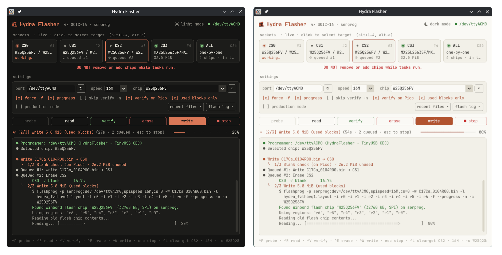

# HydraFlasher
  [](https://claude.com/claude-code)
  
  
  

  
A desktop GUI for flashing SPI flash chips with [flashprog](https://flashprog.org/)
(or flashrom) through a Raspberry Pi Pico running a modified
[pico-serprog](https://github.com/opensensor/pico-serprog) firmware.

The firmware adds up to six chip-select lines, so one Pico can serve several
sockets: HydraFlasher scans them live, flashes and verifies each chip, and logs
every run.

<p align="center">
  
</p>

## Layout

| Path | What |
| --- | --- |
| `HydraFlasher.py` | The GUI (Python, customtkinter) |
| `firmware/` | Pico serprog firmware with multi-CS, status LEDs and on-device CRC32 |

## Running the GUI

Needs Python 3.8+ with Tk, and `flashprog` or `flashrom` on the `PATH`.

```sh
pip install -r requirements.txt
python3 HydraFlasher.py
```

On Linux your user needs access to the Pico's serial port (usually the
`dialout` or `uucp` group).

## Firmware

Pinout:

| Signal | GPIO |
| --- | --- |
| SCK | GP2 |
| MOSI | GP3 |
| MISO | GP4 (pull-up) |
| CS0 to CS5 | GP5 to GP10 |
| LED busy / pass / fail | GP11 / GP12 / GP13 |

Build with the Pico SDK (`PICO_SDK_PATH` set, or a `pico-sdk` checkout in or
next to `firmware/`):

```sh
cd firmware
./build.sh          # builds build/pico_serprog.uf2
./build.sh flash    # builds, then copies it to a Pico in BOOTSEL mode
```

GitHub Actions also builds the `.uf2` on every push that touches `firmware/`.

## License

GPL-3.0, see `LICENSE`. The firmware keeps its upstream licenses
(`firmware/COPYING`, `firmware/COPYING.CC-BY-SA`).
