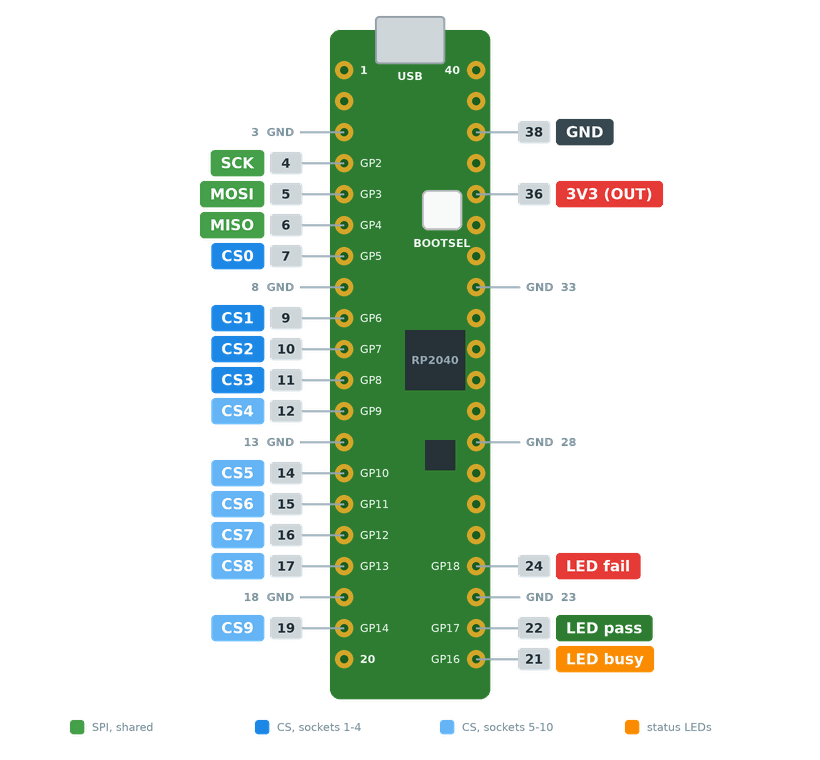

# HydraFlasher firmware

[serprog](https://www.flashprog.org/Serprog) firmware for the Raspberry Pi Pico (RP2040) that serves **several SPI flash sockets from one Pico**. It's the programmer side of the [HydraFlasher](../README.md) GUI, but it also works on its own with plain flashprog or flashrom.

It's based on [pico-serprog](https://github.com/stacksmashing/pico-serprog) by Thomas Roth ("stacksmashing"), improved by Mate Kukri ("kukrimate"), and modified for HydraFlasher by Jakub Heger.

## What it adds to pico-serprog

- **Ten chip-select lines** (CS0 to CS9) instead of one, chosen with the serprog `cs=<n>` option. **CS10 is a broadcast** that selects all sockets at once, for erasing and writing identical chips in parallel.
- **Status LEDs** for busy, pass and fail, set by the host.
- **CRC32 on the Pico.** The DMA sniffer computes a CRC32 of a flash range while it streams in at full SPI speed. Nothing goes over USB, so verifying and blank checking are much faster than reading the chip back.
- **Reboot into the bootloader** over USB, so new firmware can be flashed without pressing BOOTSEL.
- **Faster writes and erases.** When the host polls the flash status register, the Pico waits for the chip on its own (up to 5 ms) instead of answering every poll over USB.
- **Faster reads.** Reads are double-buffered with DMA: the next chunk is read from the flash while the current one goes out over USB.
- **Safe chip swapping.** When the host releases the pins (flashprog does on exit), SCK, MOSI and MISO go high-impedance. While enabled, MISO is pulled up, so an empty socket reads as `0xFF`.
- **Its own USB identity**, vendor ID `0xCAFE` and product "HydraFlasher", so the GUI finds the right serial port automatically.

## Pinout

| Signal | GPIO | Pico pin |
| --- | --- | --- |
| SCK | GP2 | 4 |
| MOSI | GP3 | 5 |
| MISO | GP4 (pull-up) | 6 |
| CS0 / CS1 / CS2 / CS3 | GP5 / GP6 / GP7 / GP8 | 7 / 9 / 10 / 11 |
| CS4 / CS5 / CS6 | GP9 / GP10 / GP11 | 12 / 14 / 15 |
| CS7 / CS8 / CS9 | GP12 / GP13 / GP14 | 16 / 17 / 19 |
| LED busy (orange) | GP16 | 21 |
| LED pass (green) | GP17 | 22 |
| LED fail (red) | GP18 | 24 |

All sockets share SCK, MOSI and MISO; each socket gets its own CS line, which idles high. The HydraFlasher GUI uses CS0 to CS3 by default; set `sockets` in its config to use up to all ten. The LEDs sit on the other side of the board, across from the CS lines. The LEDs are active high: the GPIO goes high to light one. At most one is lit at a time, and all are off at power-up.



## Building and flashing

You need the [Pico SDK](https://github.com/raspberrypi/pico-sdk), `cmake` and `gcc-arm-none-eabi`. Either set `PICO_SDK_PATH`, or put a `pico-sdk` checkout inside this folder or next to it.

```sh
./build.sh          # builds build/pico_serprog.uf2
./build.sh flash    # builds, then copies it to a Pico in BOOTSEL mode
```

`./build.sh flash` copies the firmware to the Pico's `RPI-RP2` drive. If no such drive is mounted but a Pico with this firmware is plugged in, it first reboots that Pico into its bootloader (custom command `0x21`, see below). For a Pico without this firmware, hold **BOOTSEL** while plugging it in.

GitHub Actions builds the firmware on every push that touches `firmware/` (against pico-sdk 1.5.0) and keeps `pico_serprog.uf2` and `.elf` as the `pico_serprog` build artifact.

**Releases.** Bump `FW_VERSION` in `main.c`, commit, then push a matching tag:

```sh
git tag fw-v1.1 && git push origin fw-v1.1
```

The workflow checks that the tag matches `FW_VERSION` and publishes a GitHub Release with `hydraflasher-fw-<version>.uf2`. The HydraFlasher app's settings page offers the newest one as "latest", and can also install any `.uf2` file.

## Using it with flashprog or flashrom

The Pico shows up as a USB serial port (`/dev/ttyACM0` or similar on Linux, a COM port on Windows). Choose the socket with `cs=`:

```sh
flashprog -p serprog:dev=/dev/ttyACM0,spispeed=16M,cs=0 -r backup.bin  # read CS0
flashprog -p serprog:dev=/dev/ttyACM0,spispeed=16M,cs=1 -w image.bin   # write CS1
flashprog -p serprog:dev=/dev/ttyACM0,spispeed=16M,cs=10 -E            # erase all
```

`spispeed` can be anything from 100 kHz to 50 MHz; the RP2040 picks the nearest rate it can make. Start at 16M and lower it if reads fail on long wires.

**Broadcast (`cs=10`) can't read.** All chips answer at the same time, so anything read over the broadcast is garbage. That includes the probe, flashprog's read-before-write and its verify. Erase over the broadcast first, so all chips have identical contents, write with `-n` (no verify), then verify each socket on its own. The HydraFlasher GUI does exactly this for "ALL".

## Protocol

The firmware speaks serprog interface version 1 over SPI and reports its commands through `S_CMD_Q_CMDMAP`.

Supported standard commands:
- the queries: interface, command map, programmer name (`HydraFlasher <version>`, see `FW_VERSION` in `main.c`; `pico-serprog` before version 1.1), serial buffer size, bus type, read-n and write-n maximum length;
- `SYNCNOP`;
- set bus type, set pin state, SPI operation, SPI frequency, chip select, SPI mode and CS mode.

| Limit | Value |
| --- | --- |
| Write per SPI operation | 256 bytes (one flash page) |
| Read per SPI operation | 64 KiB |
| Serial buffer | 64 bytes |
| SPI mode | Mode 0 only, CS active low (mode commands are accepted and ignored) |
| `S_CMD_S_SPI_CS` | 0 to 9 select one socket, 10 is broadcast; anything else is NAKed |

### Custom commands

Defined in `serprog.h`. Multi-byte values are little-endian; every command answers `ACK` (`0x06`) or `NAK` (`0x15`).

| Code | Name | Parameters | Answer |
| --- | --- | --- | --- |
| `0x20` | `S_CMD_SET_LED` | state (1 byte): 0 off, 1 busy (orange), 2 pass (green), 3 fail (red) | ACK |
| `0x21` | `S_CMD_BOOTSEL` | none | ACK, then the Pico reboots into its USB bootloader (`RPI-RP2` drive) |
| `0x22` | `S_CMD_CRC32` | cs (1), address bytes (1: 3 or 4), address (4), length (4) | ACK + CRC32 (4); NAK if cs ≥ 10 (no broadcast), address bytes isn't 3 or 4, or length is 0 |
| `0x23` | `S_CMD_Q_NUM_CS` | none | ACK + number of CS lines (1 byte, 10). The broadcast index is the same number. |

`S_CMD_CRC32` reads the range with `READ` (`03h`), or with `READ4B` (`13h`) when 4 address bytes are given. Chips over 16 MiB need 4 address bytes. The result is the standard zlib/IEEE CRC32, the same as Python's `zlib.crc32`. The command can't use the broadcast, since a broadcast read would be garbage.

`S_CMD_Q_NUM_CS` tells a host how many CS lines there are and so where the broadcast is. Firmware older than this command has six CS lines (CS0 to CS5) with the broadcast on 6, the LEDs on GP11 to GP13 and no `0x23` in its command map; the HydraFlasher GUI handles both.

## Notes for developers

- **Adding a custom command** touches three places:
  - its code in `serprog.h`;
  - the hand-built `cmdmap` bitmap in `main.c` (codes 32 and up go in the second 32-bit word);
  - the matching constant in `HydraFlasher.py`.

  A command missing from `cmdmap` is invisible to the GUI.
- **TinyUSB patch.** `tinyusb_patched/cdc_device.c` is a copy of TinyUSB 0.18.0's CDC driver with one change: the IN (device to host) transfer buffer gets its own size, `CFG_TUD_CDC_TX_EP_BUFSIZE` (1024). Upstream uses one size for both directions. A large OUT buffer hangs on commands that are a multiple of 64 bytes long, while a large IN buffer lets the RP2040 send several packets per USB frame. `CMakeLists.txt` compiles this file instead of the SDK's copy.

## License

As a lot of the code itself was heavily inspired/influenced by `stm32-vserprog`
this code is licensed under GPLv3.

pinout.png is an original drawing for HydraFlasher (earlier versions used one
based on Raspberry Pi Ltd's pico-pinout.svg, under CC BY-SA 4.0).
